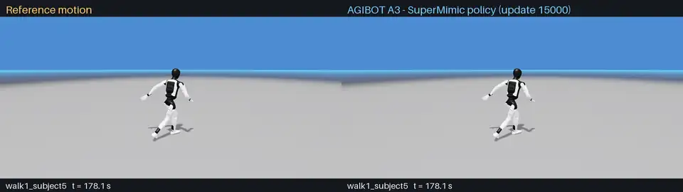

# SuperMimic Lab

[中文](README.zh-CN.md)

SuperMimic Lab is a SuperMimic training library built on Isaac Lab, primarily for
development across multiple personal robot motion control projects. It provides a reusable
training interface and an AGIBOT A3 robot training example.



*Left: reference motion. Right: AGIBOT A3 driven by the trained policy in Isaac Lab
(Newton physics, nominal parameters). Each segment starts from the reference state at the
time shown. Motions: Ubisoft LAFAN1 (CC BY-NC-ND 4.0), retargeted to A3. Recorded with
`scripts/record_a3_comparison.py`.*

**One repository contains both the reusable interface and the A3 application.**
The core and optional robot examples can be installed separately:

| Package | Purpose | Location |
| --- | --- | --- |
| `supermimic-lab` | SuperMimic learner, Runner, Isaac Lab integration and custom-task contracts | `src/supermimic_lab/` |
| `supermimic-lab-a3` | Optional A3 task using the public interface | `examples/a3/` |

The A3 package depends on the core. Other projects can use the core with their own
task package. This is an unofficial implementation based on the
[SuperMimic paper](https://arxiv.org/abs/2610.28480), with no affiliation or
endorsement from the paper authors or Isaac Lab maintainers.

## Status and scope

- Autoregressive world-model learning, imagined policy optimization, critic,
  replay, checkpoints and evaluation are implemented.
- Custom tasks use Isaac Lab configuration and Gym registration with the
  `SuperMimicRunner` interface.
- Newton/MuJoCo-Warp and PhysX adapters passed bounded A3 interface checks.
- The A3 example includes training commands, data specifications and evaluation
  definitions. Training measurements and full-length videos will be published separately.

Multi-interface joint training, velocity-command control and hardware deployment
are not implemented. Convergence, backend equivalence and paper-level performance
have not been established. See [implementation coverage](docs/IMPLEMENTATION.md)
and [validation](docs/VALIDATION.md).

## Installation

Use the Python launcher from a compatible Isaac Lab environment. The checked
integration targets the **Isaac Lab 3 development API**; arbitrary Isaac Lab 2
installations are not supported. Isaac Lab, its simulator backends and compatible
PyTorch dependencies must already be available. See [setup](docs/SETUP.md).

From this repository's root:

```bash
# Core interface for a custom task.
python -m pip install --no-deps --no-build-isolation .

# Optional A3 example from the same repository.
python -m pip install --no-deps --no-build-isolation ./examples/a3

supermimic-train --help
supermimic-evaluate --help
```

In an Isaac Sim container, use `/isaac-sim/python.sh` in place of `python`.
Robot models and motion datasets are external inputs and are not installed by
these commands.

## Train a task

A task package registers its environment, configuration and evaluator. The
standalone commands accept `module:TaskId`:

```bash
supermimic-train \
  --task my_tasks:MyProject-SuperMimic-Task-v0 \
  --env-config /path/to/task.json \
  --config /path/to/learner.json \
  --physics newton_mjwarp --num-envs 2048 --hours 3 \
  --output runs/my_task_01
```

The equivalent library interface is:

```python
from supermimic_lab.config import RunnerConfig
from supermimic_lab.runner import SuperMimicRunner
from supermimic_lab.isaaclab.environment import TransitionAdapter

# env is an initialized task implementing the documented transition contract.
env.reset()
runner = SuperMimicRunner(TransitionAdapter(env), RunnerConfig(), "runs/example")
runner.learn(num_learning_iterations=100)
policy = runner.get_inference_policy()
```

A task must provide the differentiable state, observation, reward and termination
functions needed for imagined rollouts. An existing PPO observation tensor alone
is insufficient. Follow the [custom-task guide](docs/CUSTOM_TASKS.md).

## AGIBOT A3 application test

The [A3 example](examples/a3/README.md) ([中文](examples/a3/README.zh-CN.md)) uses
the same public interface with AGIBOT A3 and retargeted reference motions. It includes:

- Training, evaluation and optional visualization commands.
- A 2048-environment, single-GPU configuration with full network widths.
- [Data format and availability](examples/a3/DATA.md).
- [Direct original-LAFAN1 preparation and fresh 4096-environment training](data_processing/README.md).
- [Evaluation protocol and metric definitions](examples/a3/EVALUATION.md).

The example provides a pinned official A3 model downloader, an Isaac Lab USD
conversion script and a runtime motor profile. Compatible retargeted motion CSVs
remain external. Models, datasets and pretrained weights are not bundled in wheels.
This source release does not include training records, checkpoints or demonstration videos.

## Documentation

| Document | Contents |
| --- | --- |
| [Setup](docs/SETUP.md) | Environment, installation and backend requirements |
| [Architecture](docs/ARCHITECTURE.md) | Core, adapters and task-package boundaries |
| [Custom tasks](docs/CUSTOM_TASKS.md) | Registration and differentiable task contracts |
| [Implementation](docs/IMPLEMENTATION.md) | Paper coverage, assumptions and limitations |
| [Validation](docs/VALIDATION.md) | Executed checks and their scope |
| [Contributing](CONTRIBUTING.md) | Development and reporting reproducible issues |
| [Provenance](PROVENANCE.md) | Algorithm sources and external-data attribution |

## License and citation

Code is licensed under [MIT](LICENSE). Isaac Lab, simulator dependencies, robot
assets and motion data retain their respective licenses.

Please cite Liao et al., *SuperMimic: Scaling Humanoid Whole-Body Control with One
Differentiable World Model*, when using the method. Citation metadata is available
in [CITATION.cff](CITATION.cff).
